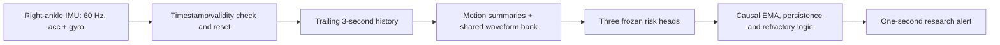

# Scientific decision and three-track plan — 2026-11-11

## 1. Diagnosis and supportable question
Question: Can a causal, single-right-ankle accelerometer/gyroscope pipeline start useful warnings 2–5 seconds before annotated FoG while limiting notification burden, and how does performance transfer between people?
Hypothesis for future locked assessment: the frozen system warns at least 90% of observable annotated onsets, with at most one scored unsuccessful start/hour and bounded one-second pulses. This is an engineering research hypothesis, not a clinical safety claim. Existing development evidence does not support accepting it.

Artifact audit: 7/16 successes, mean lead 4.038 s, 0 scored unsuccessful starts over 653.617 s (10.89 min), one unknown boundary alert. FS15 6/10; FS16 0/1; FS17 1/5; FS18 no episodes. The participants—not 2,622 overlapping predictions—are the independent sampling units. Six of nine misses have all raw head scores below their own thresholds; three have transient raw crossings but no smoothed crossing. No episode lacks eligible prediction windows. episodes.csv lists every onset and head diagnostic. These are descriptive failure locations, not biological causal explanations.

Cross-person variation and calibration instability have direct supporting evidence: success concentration, failed separate-calibration models, weak repeat-seed performance, and prior Stanford transfer failure. Lack of predictive sensor information is plausible but unproved. Orientation/placement mismatch is not demonstrated as the immediate explanation: explicit ankle channels, native rates and unit tests are documented; physical mounting cannot be verified from software. Label timing uncertainty remains unquantified without independent re-annotation. The three transient-score misses suggest filtering costs, but prior faster-response failures show the false-alert tradeoff. No sustained-threshold/state-only miss was found under the current thresholds; this is not a proof that every possible alarm policy is optimal.

Strongest contribution: a reproducible causal warning prototype plus a rigorous demonstration of current single-ankle prediction limits and engineering notification burden. Better prediction is an experimental aim; low desktop computation time does not establish clinical usefulness.

## 2. Ranked actions
| Rank / track | Action | Expected value | Risk | Effort / allowed data |
|---|---|---|---|---|
| 1 / B+A | Saved-artifact episode audit and replay/hash verification | Explains failure classes before searching | Low; retrospective diagnostics only | 1–3 h; development artifacts only; implemented |
| 2 / B | Snapshot v2 and write locked protocol with readiness gates | Preserves remaining evidence | Premature release wastes assessment | 1 day; source/weights only; draft freeze created |
| 3 / C | Prerecorded demo and bench latency instrumentation | Strong engineering evidence | Hardware/setup not specified | 2–5 days; known development recordings and benchtop hardware |
| 4 / A | E1 calibration feasibility and paired comparison | Tests cross-person scale hypothesis | Invalid walking setup or cold-start loss | 1–2 days; existing development people only |
| 5 / A | E2 training-only self-supervised representation | Tests diversity/representation hypothesis | Prior pretraining already failed | 2–4 days; eligible raw training cohorts only |
| 6 / A | E3 transition-aware state model | Tests three filtered-score misses | Extra false/unknown alerts | 1–2 days; development replay only |

## 3. Three bounded experiments (plans only; not run here)
Common evaluation: historical development, not independent testing. Primary paired participant-level sensitivity difference and unsuccessful starts/hour; also total episode sensitivity with all onsets, unknown alerts, false occupancy, pulse duration, lead per matched episode, missing-data coverage and latency. Always report event-weighted and participant-macro outcomes separately; no window bootstrap. Use folds training 1–10/calibration 11–14/outer development 15–18 initially; rotate these prespecified groups only if every fold is included and aggregate reported without tuning on outer results. No further feature/threshold revision after outer results. Fit a matched baseline on each training fold; v2 remains the frozen deployment/research reference, not a fair disjoint-fit comparator because it trained on 1–14.

Promotion common rule: no lost or later previous successful warnings on matched recordings, no increased scored false starts or unknown alerts, same denominators/exposure, one-second pulses and no worse false occupancy. Require at least two extra developmental episodes spanning at least two people, positive participant-macro paired gain, and no increase in per-person false-start burden. Preserve every failed fold; disabled policy fails. If gain is timing-only it is an engineering improvement, not improved episode coverage. Any nominee must pass full streaming parity and be newly frozen before reserved review. A failed prerequisite is recorded, never repaired by selecting a nicer recording.

E1 — Causal wearer calibration (highest prospective performance priority, conditional).
Rationale: six misses are below raw thresholds and successes cluster by person; amplitude/scale mismatch is plausible. Hypothesis: an initial, externally confirmed non-FoG walking period improves later-person score calibration without extra alerts.
Select the first chronological recording and its first contiguous 20 s by time alone; do not search labels for a suitable segment. Walking confirmation must come from fixed task annotations or a supervised setup instruction, since a normal/FoG-negative label can include standing. If unavailable, stop this experiment at feasibility and report the prerequisite failure. Do not presume all initial samples are walking. Setup records are fixed before any label checks. Record any setup FoG or insufficient coverage; do not select a replacement. In a future device setup, confirmation must be available before adaptation, not from future annotations.
Change only normalization of the 24 motion-summary features: use the fixed setup median and 1.4826*MAD, with scale floor max(0.01, 0.1*training-feature standard deviation) for each feature. Raw acceleration/rotation and their physical unit conversion remain unchanged. Require at least eight setup feature endpoints; normalization becomes available only after the full 20-second setup ends, never retroactively. No alerts are produced by the adapted arm during setup. This is an experimental transform requiring a matched model fit, not a plug-in change to v2. Compare fixed training normalization versus this single setup normalization with the same Dense32 architecture, seed42, 24 fixed epochs, capped positive weight10. One model per arm/fold; existing 37-point calibration grid once. No setup labels train the classifier. Keep setup onsets in the primary all-onset denominator as unpredicted; report later-recording denominator separately, never compare it directly with 7/16. Stop after the prespecified paired folds. Failure distinguishes setup feasibility and amplitude adaptation from a need for broader features. Estimate 20–60 min/fold CPU plus one day implementation.

E2 — Self-supervised masked-motion learning on eligible raw training recordings.
Rationale: weak transfer and small cohort diversity remain plausible despite failed turning auxiliary pretraining; a label-free motion objective on raw compatible recordings differs from learning turning/FoG detection on noncausally filtered data.
Hypothesis: masked reconstruction using raw FoG-STAR training people and Stanford training people 1–4 improves outer-person early prediction relative to an otherwise identical random-initialized model. Exclude turning zero-phase-filtered release, all reserved people, and all outer/calibration people from pretraining. Establish and test the fixed 128-to-common-rate causal mapping on training data before admission; otherwise stop as incompatible. No whole-recording target-person normalization.
Architecture fixed: one GRU32 encoder, Dense reconstruction head; mask a random 20% of the already-observed three-second window, seed42, 10 pretraining epochs; then shared classifier Dense32, 16 fixed supervised epochs. Masked reconstruction may see other samples within the historical window; supervised inference never sees after its endpoint. One pretrained and one scratch arm, no architecture sweep. Freeze all settings before fitting; same three groups and common rules. Stop after paired folds, including a failed/disabled model. Failure tests whether this modest raw-motion transfer adds value beyond the already-failed auxiliary detection approach; it does not rule out all representation learning. Estimate 1–3 CPU h/fold; two implementation days. Lower priority than E1 because earlier transfer/pretraining failures reduce expected value.

E3 — Fixed transition-aware risk model.
Rationale: three misses contain brief raw peaks removed by smoothing; six do not. A state model can address only the supported part of this gap, not invent absent information. Hypothesis: modeling observed risk transitions improves persistence of true precursors without reacting to isolated stopping/turning spikes.
Inputs are three frozen head scores and their prior-only one-second differences; no subject, task or current FoG label at inference. Train one three-state hidden Markov model (normal, pre-onset, active) on training sequences; state labels used in training only, diagonal transition pseudocount20 and all other pseudocount1; diagonal Gaussian emissions with variance floor0.01; forward filtering only, no Viterbi backtracking or backward smoothing. Positive state is exactly the fixed 2–5 s pre-onset interval; late normal state is explicit. Use one fixed model with existing two-step persistence/pulse policy; one calibration threshold grid. Do not train score heads on the held calibration/outer people; use fold-fitted heads. One model/fold; stop after prespecified paired folds. Failure quantifies the sensitivity/burden cost of transient risk rather than just adding another architecture. Estimate 5–20 min/fold after score generation, one implementation day. Earlier generic four-state/LSTM failures make this strictly secondary and conditional on the audit.

## 4. Locked assessment
See LOCKED_ASSESSMENT_PROTOCOL.md and freeze_manifest.json. The freeze is a review snapshot, not authorization or a claim of readiness. No raw or reserved cohort has been opened. Stanford 6–7 remain excluded from release because the 60-Hz candidate lacks a frozen verified 128-Hz streaming contract. Any new candidate invalidates this freeze and requires a new unique review bundle.

## 5. Hardware/demo plan
Hardware decision needed: IMU model/range, processor, sample transport, timestamp source and alert actuator. Bench only, no patient intervention. Secure the sensor at the study's right ankle/lower-shank location; foot/shoe placement is a different domain. Record six channels, units and measured rate. Replay a predetermined development recording with all true/missed episodes and unknown alerts visible; it is prerecorded input, not a new patient trial. Keep simulator/demo separate from clinical claims.
Instrument sample acquisition, receiver, completed feature window, model completion, command output and physical actuator onset using shared clock or measured synchronization; use GPIO/logic analyzer or synchronized microphone/photodiode/accelerometer for actuator timing. At least 30 min continuous benchtop logging, 100 prescribed alert commands, startup/reset, packet loss, timestamp reversal, CPU load and battery tests. Report median/p95/max sensor-to-physical-alert latency and jitter; subtract measured delivery latency when reporting delivered lead. The 250-ms scheduling period and three-second startup must be shown separately from compute time. Measure cue perceptibility separately; a one-second pulse is not a validated clinical dose. If hardware is absent, present desktop timing only and clearly mark end-to-end latency unmeasured.

## 6. Science-fair package
Poster: question/hypothesis; sensor and causal architecture; locked experimental design; participant table; episode timeline and score-failure matrix; baseline/failed-alternative table; notification/latency engineering; limitations and future work. Use 7/16 over 10.89 min and one unknown alert prominently, not accuracy alone. Keep development, limited locked assessment and clinical validation in separate columns. Show per-person no-FoG participant as N/A sensitivity, not zero. Use existing paired timing artifacts and distinguish hardware timings when available.

At endpoint t, input is [t−3,t]; only an actual warning START at t can match an onset in [t+2,t+5]. Mark [t,t+2) as too late and recording tails as unknown where follow-up is missing. This timing diagram should appear beside the system diagram.

Judge explanation: “I studied whether one ankle sensor can warn before freezing, rather than recognize freezing after it starts. My causal prototype warned before seven of sixteen development episodes and reduced notification and computation burden. It still missed nine. I preserved unsuccessful experiments, separated people in development analyses, and protected reserved data so the project demonstrates both engineering progress and the current limits.”

Reproduce safe review: `python -m unittest test_development_evidence_review`; `python development_evidence_review.py --output runs/NEW_UNIQUE_REVIEW`. This opens saved development predictions, never raw datasets. Existing `ankles.py ensemble` is an offline replay, but its current loader reads the combined raw CSV before subject filtering; DO NOT run it during the reserved-access embargo. A future approved reserved loader must authorize access before raw-file opening and retain only selected rows. Historical whole-file parsing prevents claiming that current reservations are provably pristine; describe their preserved evaluation status and uncertain historical exposure honestly.

## 7. Explicitly do not
No broad model/threshold sweep; no reserved access now; no repeated outer tuning; no repeated seeds until a win; no more DMD/nonlinear-bank/longer-history trials without a new mechanism; no target or denominator changes; no future filters or hindsight onset gates; no oracle removal of active FoG; no disabled-policy success; no window-based significance; no deletion of failures; no normal=walking assumption; no zero-real-world-false-alarm claim; no patient-use demonstration; no borrowed detection score as prediction evidence.

## 8. Best immediate action and outcome
Implement a saved-artifact missed-episode review, reproduce alarm states and check artifact hashes, without modifying inference/scoring or opening raw data. Completed in this bundle: episodes.csv, participants.csv, summary.json; 2,622 states reproduced, seven successes/nine misses, all stored artifact hashes match, and seven diagnostic tests pass. Freeze is pending final review; no experiment or reserved assessment is authorized by this document.
